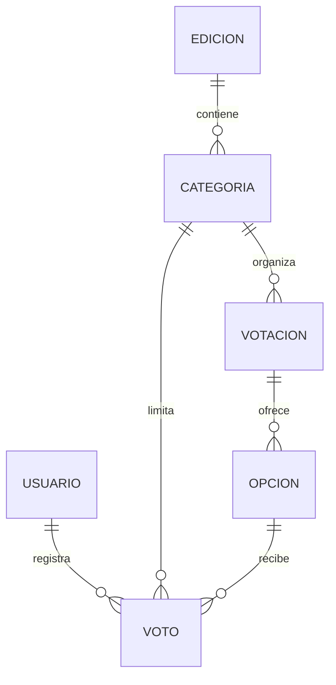

# Arquitectura, decisiones y API

Edición 1:N Categoría 1:N Votación 1:N Opción; Usuario 1:N Voto; Categoría 1:N Voto; Opción 1:N Voto.
Voto.edicion se deriva de Voto.categoria.edicion; no duplica una FK que podría contradecir la categoría.
UniqueConstraint(usuario,categoria) garantiza la regla porque el ID de categoría ya identifica su edición.
El padre de categoría/votación/opción es inmutable mediante save/clean y las interfaces disponibles.



La confirmación obtiene usuario de sesión y revalida pertenencia, disponibilidad y participación.
El servicio festival/services.py bloquea la categoría dentro de atomic y registra; Categoria.save participa en ese mismo bloqueo cuando se cierra desde Admin. Esto serializa la participación de una categoría (decisión simple para fase académica, sin pruebas de carga).
Voto.save verifica pertenencia y estado; la restricción SQL es la última defensa ante duplicados. IntegrityError se procesa fuera de atomic; solo el error MySQL 1062 de la restricción esperada se traduce en duplicado, otros errores se propagan para diagnóstico.
No se promete integridad cruzada frente a SQL arbitrario: las FKs separadas y la unicidad SQL no comprueban por sí solas opcion.votacion.categoria. Solo se habilitan vías Django validadas.

## GET /api/categorias/

Archivo: festival/views.py, función api_categorias. Ruta: festival/urls.py.
Pública, solo GET, no escribe datos. Consulta con select_related y prefetch_related. Incluye categorías abiertas/cerradas y vacías, con edición y opciones de todos sus subeventos. No expone usuarios ni votos individuales.

Ejemplo ilustrativo (IDs reales asignados por MySQL pueden variar):
```json
{"categorias":[{"id":1,"nombre":"Ejemplo E3: acordeón","habilitada":true,"edicion":{"id":1,"anio":2027,"nombre":"Edición de prueba 2027"},"opciones":[{"id":1,"nombre":"Ejemplo 1-A","votacion":{"id":1,"titulo":"Subevento de ejemplo 1"}}]}]}
```

## Fuentes oficiales consultadas, 30/10/2026

Django Software Foundation. Database transactions (Django 5.2). https://docs.djangoproject.com/en/5.2/topics/db/transactions/
Django Software Foundation. Constraints reference (Django 5.2). https://docs.djangoproject.com/en/5.2/ref/models/constraints/
Fotografía: ver static/img/CREDITOS.md.
Guía académica: Fundación Universitaria del Área Andina. Actividad evaluativa – Eje 3, documento aportado por el estudiante (sin inventar autor individual).
